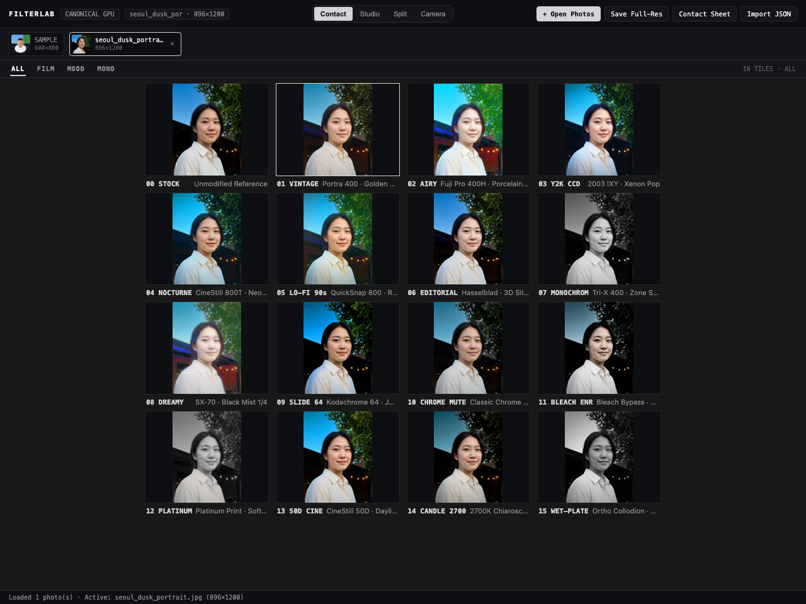
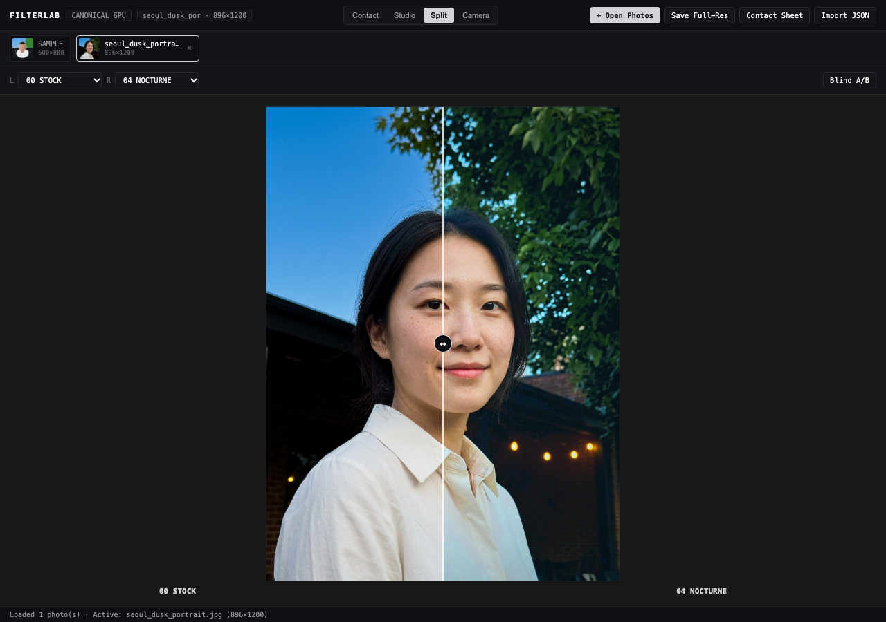
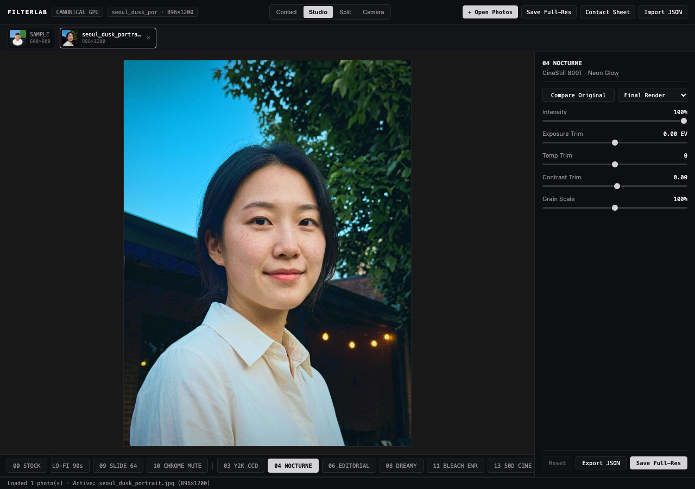
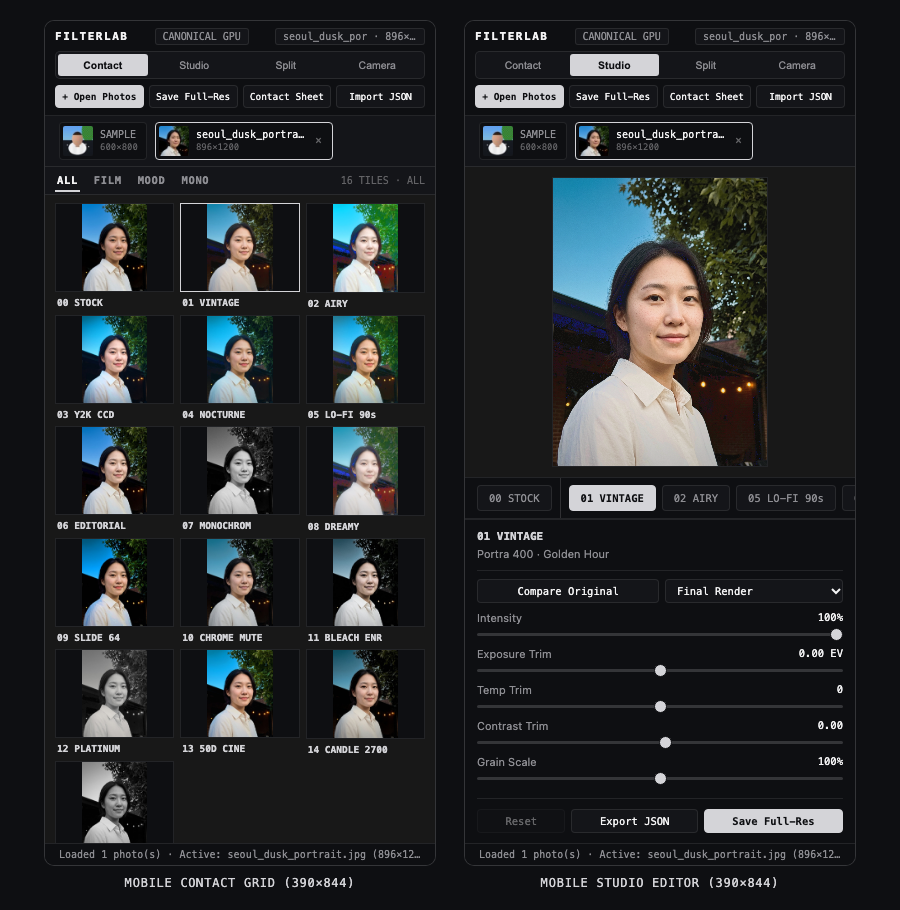
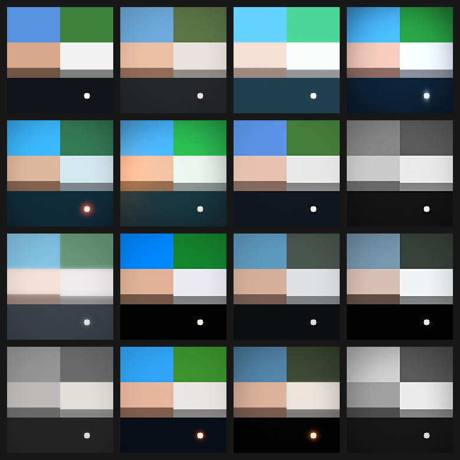

# FilterLab — Film Darkroom Studio (WebGL2 & macOS Metal)

> **사진작가·컬러 사이언티스트 페르소나 합의를 단일 광학 계약(`shared/recipes.json`)으로 컴파일해, 브라우저(WebGL2)와 macOS(Metal)에서 1:1 동일한 필름 감성을 구현하는 다크룸 스튜디오.**

- **라이브 웹 다크룸 (GitHub Pages)**: https://iamywl.github.io/iCam/
- **네이티브 테스트 랩**: [`mac/`](./mac) (`SwiftUI` + `Metal` macOS 앱 `FilterLab.app`)

스마트폰 기본 카메라("기카")로 찍은 사진을 브라우저에 바로 불러와 **인물 피부톤 존엄성(25° 스킨 보호)** 과 **물리 기반 H-D 톤 커브·점광원 할레이션·블랙 미스트·밀도 의존형 입자**로 현상할 수 있으며, 전역 `CSS hue-rotate()`·흙탕물 `sepia()`·인위적 UI 광택을 일절 배제합니다.

---

## 한눈에 보기 (Visual Tour)

> 기본 카메라 사진을 WebGL2 다크룸에 올린 실제 동작 화면입니다. 기카 원본(`00 STOCK`)과 15종 필름·무드·흑백 프리셋을 한 번에 비교하고, 1:1 분할 비교와 세부 현상 후 풀해상도 JPEG / 4×4 밀착 시트로 저장할 수 있습니다.

### 1. `4×4` Contact Grid — 기카 원본(`00 STOCK`) + 15종 감성 한눈에 비교 (`ALL · FILM · MOOD · MONO`)


### 2. 기카 vs 필름 1:1 분할 비교(`Split`) & 세부 현상(`Studio`)
| `Split` — 기카(`00 STOCK`) vs `04 NOCTURNE` 드래그 비교 | `Studio` — 점광원 할레이션 · 슬라이더 튜닝 · 풀해상도 저장 |
| :---: | :---: |
|  |  |

### 3. 모바일 웹 다크룸 (`390×844` 반응형) & macOS Metal GPU 광학 검증
| 모바일 다크룸 (`Contact` 3열 & `Studio` 터치 편집) | macOS `FilterEngineTests` Metal GPU 16-up 캘리브레이션 |
| :---: | :---: |
|  |  |

---

## 핵심 아키텍처 (Single Source of Truth)

```text
          [ shared/recipes.json ]  (schemaVersion: 2 · 15종 공식 레시피 단일 소스)
                     │
        ┌────────────┴────────────┐
        ▼                         ▼
 [ mac/ (Swift + Metal) ]   [ web/ (WebGL2 + GLSL ES 3.00) ]
  • FilterEngine 모듈         • webgl-filter-engine.js (동일 다단 광학 셰이더)
  • RGBA16Float 선형 파이프   • RGBA16F FBO 멀티패스 (미지원 시 RGBA8 자동 폴백)
  • FilterLab.app 다크룸      • 해상도 비례 스케일 불변 블러(tapStep / uTapStep)
  • 3D .cube LUT 내보내기     • GitHub Pages 정적 호스팅 (로컬 서버 상시 구동 제로)
```

- **Metal ↔ WebGL2 수식 동등성**: [`OpticalShaderSource.swift`](./mac/Sources/FilterEngine/OpticalShaderSource.swift)와 [`webgl-filter-engine.js`](./web/js/webgl-filter-engine.js)가 동일한 실행 순서로 동작합니다.
  1. `3×3` 선형 색 교차 행렬(`colorMatrix` + `skinMatrixShield`) & 가중 흑백 믹서(오렌지 필터 / 정색성 습판)
  2. 4존 H-D 필름 톤 커브 (Black Pedestal · Shadow Toe · Pivot S-Curve · Highlight Shoulder)
  3. 25° 중심 피부 마스크 기반 선택적 색상 변조 · 휘도 보존 피부 크로마 스무딩 · 스플릿 토닝
  4. 분리형 2-Pass 점광원 할레이션 / 수직 CCD 블루밍 · 블랙 미스트 하이라이트 확산
  5. 블리치 바이패스 은잔류(`bleachBypassAmount`) · 3D 팝 마이크로 대비 · 밀도 의존 그레인 · 코사인 4승 광학 비네팅 / 빛샘

---

## 15종 큐레이션 감성 카탈로그 (`00 STOCK` + `01..15`)

`01..08` 핵심 기둥 감성에 `09..15` 확장 필름·시네마·아트 프린트를 더해 총 **16슬롯(`4×4` Contact Grid)** 을 구성하며, 웹에서는 **`ALL · FILM · MOOD · MONO`** 계열 필터로 탐색할 수 있습니다.

| # | Short Label | ID (`recipes.json`) | 분류 | 이름 | 무드 레퍼런스 (`moodCue`) |
| :-: | :--- | :--- | :-: | :--- | :--- |
| **00** | `00 STOCK` | *(Baseline Bypass)* | `all` | 원본 기준 (기카 비교) | Unmodified Reference |
| **01** | `01 VINTAGE` | `01_vintage_35mm` | `film` | 클래식 빈티지 필름 | Portra 400 · Golden Hour |
| **02** | `02 AIRY` | `02_airy_summer` | `film` | 청량 여름 파스텔 | Fuji Pro 400H · Porcelain Sun |
| **03** | `03 Y2K CCD` | `03_y2k_flash` | `mood` | Y2K 디카 직광 플래시 | 2003 IXY · Xenon Pop |
| **04** | `04 NOCTURNE` | `04_nocturne_cinema` | `mood` | 야간 시네마 할레이션 | CineStill 800T · Neon Glow |
| **05** | `05 LO-FI 90s` | `05_lofi_youth` | `film` | 일회용 필름 로파이 | QuickSnap 800 · Raw Grain |
| **06** | `06 EDITORIAL` | `06_editorial_mf` | `mood` | 에디토리얼 중형 화보 | Hasselblad · 3D Silk Clarity |
| **07** | `07 MONOCHROM` | `07_pure_monochrome` | `mono` | 정통 은염 흑백 | Tri-X 400 · Zone System |
| **08** | `08 DREAMY` | `08_dreamy_instant` | `mood` | 몽환 즉석 블랙 미스트 | SX-70 · Black Mist 1/4 |
| **09** | `09 SLIDE 64` | `09_slide_reversal` | `film` | 포지티브 슬라이드 64 | Kodachrome 64 · Jewel Slide |
| **10** | `10 CHROME MUTE` | `10_chrome_mute` | `film` | 클래식 크롬 다큐 | Classic Chrome · Slate Day |
| **11** | `11 BLEACH ENR` | `11_bleach_enr` | `mood` | 블리치 바이패스 은잔류 | Bleach Bypass · Silver Steel |
| **12** | `12 PLATINUM` | `12_platinum_print` | `mono` | 백금-팔라듐 아트 프린트 | Platinum Print · Soft Fiber |
| **13** | `13 50D CINE` | `13_daylight_cinema` | `mood` | 데이라이트 시네마 50D | CineStill 50D · Daylight Print |
| **14** | `14 CANDLE 2700` | `14_candle_chiaroscuro` | `mood` | 캔들라이트 2700K 암실 | 2700K Chiaroscuro · Velvet Dark |
| **15** | `15 WET-PLATE` | `15_wet_plate_ortho` | `mono` | 오소크로매틱 습판 인화 | Ortho Collodion · Blue Sculpt |

---

## 주요 앱 구성 & 사용법

### 1. Web Darkroom Studio (`web/`)
별도 설치 없이 브라우저에서 기카 사진을 현상합니다.
- **Contact (`ALL · FILM · MOOD · MONO`)**: 데스크톱 `4×4` 16타일 일괄 비교 (모바일 `ALL` 3열 / 카테고리 필터 시 2열, `00 STOCK` 항상 첫 타일 고정).
- **Studio**: 좌측 고정 `00 STOCK` 버튼 + 계열 구분 필름 다이얼(`[`, `]`, `←`, `→` 이동), `Space` 홀드 원본 비교, 마스크 디버그 오버레이(`Final Render` / `Skin Mask` / `Halation Emitter` / `Mist Diffusion`), `Intensity · Exposure · Temp · Contrast · Grain` 튜닝, **Save Full-Res**(원본 풀해상도 JPEG) 및 **Contact Sheet**(`4×4` PNG 시트) 내보내기.
- **Split & Blind A/B**: 드래그 와이프 비교 및 감성 이름을 가린 블라인드 테스트.
- **Camera (옵트인)**: `Camera` 탭을 직접 열 때만 카메라 권한을 요청하는 실시간 뷰파인더(`3:4`·`4:3`·`16:9` 비율 전환, 렌즈 전환, 정지, 다크룸 캡처).
- **Mac → Web 핸드오프**: 맥 앱에서 튜닝한 레시피를 `#recipe=` URL 해시로 퍼블릭 웹 다크룸(`https://iamywl.github.io/iCam/`)에 즉시 로드하거나 `Import JSON`으로 불러올 수 있습니다.

### 2. macOS Native `FilterLab.app` (`mac/`)
macOS 14+ 환경에서 SwiftPM으로 빌드되는 네이티브 다크룸/캘리브레이션 앱입니다.
- **모드 전환**: Contact Grid (`⌘1`), 1:1 Split Compare + 루페 (`⌘2`), Solo Inspection (`⌘3`), Live Mac / Continuity Camera (`⌘4`), 빠른 전환(`Space` 원본 비교, `⌘B` 블라인드 A/B, `⌘R` 줌/팬 리셋).
- **입출력**: 이미지 드래그 앤 드롭 / `⌘O` / 클립보드 붙여넣기(`⌘V`), 풀해상도 내보내기(`⌘E`), Contact Sheet PNG(`⇧⌘E`), `shared/recipes.json` 직접 저장(`⌘S`), 33³ `.cube` 3D LUT 내보내기(`⇧⌘L`).

---

## 저장소 구조 (Repository Layout)

```text
.
├── AGENTS.md                           # 워크스페이스 절대 원칙 및 에이전트 거버넌스 헌법
├── AESTHETICS.md                       # 8대 핵심 감성 스펙트럼 & 5대 금지 안티패턴 기준
├── DEVELOPMENT_PLAN.md                 # Metal + WebGL2 통합 아키텍처 및 8단계 파이프라인 설계
├── shared/
│   └── recipes.json                    # schemaVersion 2 · 15종 공식 광학 레시피 단일 소스
├── docs/
│   └── screenshots/                    # README 시각 투어용 실동작 Web/Metal 캡처 이미지 (5종)
├── web/                                # GitHub Pages 배포용 무의존성 WebGL2 다크룸 스튜디오
│   ├── index.html
│   ├── styles.css
│   └── js/
│       ├── app.js                      # Darkroom UI, 상태 관리, Full-Res / Contact Sheet 내보내기
│       ├── recipes.js                  # EMBEDDED_DEFAULT_CATALOG (recipes.json과 CI에서 1:1 검증)
│       ├── webgl-filter-engine.js      # WebGL2 RGBA16F 멀티패스 광학 셰이더 엔진
│       └── camera-controller.js        # 옵트인 getUserMedia 뷰파인더 컨트롤러
├── mac/                                # macOS 14+ Swift Package (FilterEngine + FilterLabApp)
│   ├── Package.swift
│   ├── build-app.sh                    # Release .app 번들 패키저 (.build/FilterLab.app)
│   └── Sources/
│       ├── FilterEngine/               # iOS/macOS 공용 Metal 셰이더 · 레시피 · .cube LUT 엔진
│       ├── FilterEngineTests/          # Apple GPU 기반 15종 수치 검증 및 calibration_sheet.png 생성
│       └── FilterLabApp/               # SwiftUI/AppKit 다크룸 UI 및 Continuity Camera 호스트
├── personas/                           # 11인 사진작가 · 컬러 사이언티스트 · 촉각 디자이너 도시에
├── .agents/
│   ├── agents/                         # 역할 분리 & VETO 권한을 지닌 14종 전문 에이전트 정의
│   └── skills/persona-council/         # 위원회 소집 및 감성 검수 워크플로우 스킬
└── .github/workflows/
    └── deploy-pages.yml                # JS 문법 · recipes parity 검증 후 GitHub Pages 자동 배포
```

---

## 검증·빌드 및 배포 명령어

### 1. macOS Metal GPU 테스트 및 `.app` 빌드
```bash
cd mac
SWIFT_BACKTRACE=enable=no swift run FilterEngineTests
./build-app.sh
```
- `FilterEngineTests`: `shared/recipes.json` 15종 전수 Metal GPU 렌더링, 피부톤·할레이션·`.cube` LUT(4,917줄) 검증 및 `mac/.build/calibration_sheet.png` 생성.
- `./build-app.sh`: `mac/.build/FilterLab.app` 번들 생성 (`Contents/Resources/recipes.json` 내장).

### 2. Web JS 문법 및 `recipes.json` 정합성 검증
```bash
node --check web/js/recipes.js web/js/webgl-filter-engine.js web/js/camera-controller.js web/js/app.js
node --input-type=module -e "
  import fs from 'node:fs';
  import { EMBEDDED_DEFAULT_CATALOG } from './web/js/recipes.js';
  const canonical = JSON.parse(fs.readFileSync('./shared/recipes.json', 'utf8'));
  if (JSON.stringify(EMBEDDED_DEFAULT_CATALOG) !== JSON.stringify(canonical)) process.exit(1);
  console.log('OK:', canonical.schemaVersion, canonical.aesthetics.length);
"
```

### 3. CI/CD 자동 배포
- `main` 브랜치에 푸시하면 [`.github/workflows/deploy-pages.yml`](./.github/workflows/deploy-pages.yml)이 위 Web 검증을 실행하고 `web/`과 `shared/recipes.json`을 합쳐 https://iamywl.github.io/iCam/ 에 자동 배포합니다. (로컬 HTTP 서버 상시 구동은 사용하지 않습니다.)

---

## 거버넌스 & 페르소나 위원회

모든 새 감성 추가, 셰이더 수식 변경, UI 레이아웃 수정은 [`AGENTS.md`](./AGENTS.md)와 [`.agents/skills/persona-council/SKILL.md`](./.agents/skills/persona-council/SKILL.md)의 페르소나 위원회 절차를 따릅니다.

- [`AESTHETICS.md`](./AESTHETICS.md) — 감성 철학 및 기카 대비 3초 블라인드 테스트 기준
- [`personas/README.md`](./personas/README.md) — 11인 사진작가·장인 페르소나 인덱스
- [`.agents/agents/README.md`](./.agents/agents/README.md) — 14종 에이전트 역할 및 VETO 파이프라인
