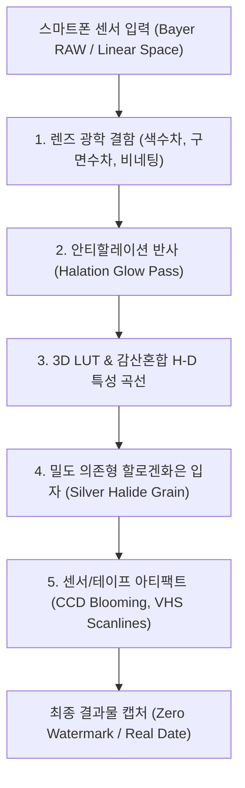

# 📷 빈티지 카메라 앱 벤치마크 조사 및 물리 기반 구현 기술 분석 보고서
> **문서 ID**: `DOC-RES-2026-001`  
> **작성일자**: 2026-11-07  
> **분류**: Optics, Color Science, GPU Shader Pipeline & Tactile Interaction Research  
> **대상 앱**: Dazz Cam, NOMO CAM, FIMO, Gudak/Huji, Leica LUX, RNI Films, Halide  

---

## 1. 글로벌 리딩 빈티지 카메라 앱 벤치마크 요약

| 앱 명칭 | 주력 시뮬레이션 대상 | 핵심 기술 및 감성 포인트 |
| :--- | :--- | :--- |
| **Dazz Cam** | 80~90년대 35mm 필름 (GR D, Classic U), 롤라이플렉스(이안반사식), Y2K CCD 디카 (CPM35, FXNR) | • 스마트폰 기본 Smart HDR/Deep Fusion 우회 (RAW 파이프라인) • 광학 수차(색수차, 배럴 왜곡, 코마) 및 프리즘/스타 필터 실시간 셰이더 • 하이라이트 할레이션(Red Halation) 물리 확산 렌더링 |
| **NOMO CAM** | 인스탁스 / 폴라로이드 즉석카메라, 로모 LC-A, 일회용 퀵스냅 | • 화학 인화 유제 현상(Development) 시간 (스마트폰 흔들기 가속 센서 연동) • 래칫 휠, 모터 롤러 기계음 및 햅틱 싱크 • 프레임별 난수 기반 빛샘(Light Leak) 및 유제 불균일성 |
| **FIMO** | 코닥 포트라 400, 후지 수페리아, 아그파 비스타 등 35mm 명품 필름 롤 | • 필름 팩 카트리지 교체 인터페이스 • 뷰파인더 쿼츠데이트(Quartz Date) 오렌지 LED 각인 • 35mm 필름 퍼포레이션(스프로킷 홀) 및 필름 프레임 렌더링 |
| **Gudak / Huji** | 후지 퀵스냅(写ルンです) 등 90년대 일회용 카메라 | • 바늘구멍(Pinhole) 뷰파인더로 시야 제한 (극도의 아날로그 재현) • 24컷 완료 후 3일 뒤 인화되는 슬로우 포토그래피 • 일회용 플래시 발광 시 생기는 강한 명암 대비와 하얗게 바래는 톤 |
| **Leica LUX** | 라이카 M 주밀룩스(Summilux), 녹티룩스(Noctilux) 광학계 | • Apple ProRAW 기반 14-bit 선형 씬 레퍼드(Scene-Referred) 변환 • 물리 조리개 기반 보케(Bokeh) 수차 및 렌즈 비네팅 시뮬레이션 |

---

## 2. 빈티지 카메라 구현을 위한 6대 핵심 기술 파이프라인

현대 스마트폰 카메라는 지나치게 선명하고 평평한 '디지털 이미지'를 만듭니다.  
성공한 빈티지 카메라 앱들은 다음 6단계의 렌더링 파이프라인을 통해 디지털 센서의 완벽함을 깨뜨리고 아날로그 광학/화학 법칙을 모사합니다.

---

### [파이프라인 1] 스마트폰 과보정(Smart HDR/Deep Fusion) 무력화
- **문제**: 스마트폰 ISP는 섀도우를 인위적으로 올리고, 명부를 깎으며, 에지에 과도한 언샤프 마스크(Unsharp Mask)를 적용함.
- **해법**:
  - `AVCapturePhotoOutput` / Camera2 API에서 제조사 후처리가 배제된 **Linear RAW/ProRAW 데이터 스트림** 직접 취득.
  - 샤프닝 및 디노이즈 파라미터를 0으로 강제하여 센서 본래의 질감 보존.

---

### [파이프라인 2] 감광 화학 유제 커브 (Hurter & Driffield S-Curve)
필름은 빛에 선형 반응하지 않고, 화학 유제의 포화 한계를 따르는 시그모이드(S자) 반응을 보입니다:

$$\text{Density} = \frac{D_{\max}}{1 + e^{-\gamma (\log E - \log E_0)}} + D_{\min}$$

- **토우(Toe, 암부 들뜸)**: 딥 섀도우가 디지털 블랙(`#000000`)으로 떨어지지 않고, 필름 베이스 틴트가 섞인 웜 그레이(`#121418`)로 부드럽게 들뜸.
- **숄더(Shoulder, 하이라이트 롤오프)**: 강한 햇빛이나 조명이 타서 클리핑되지 않고, 곡선 상단에서 완만하게 압축(Highlight Compression)되어 유연한 디테일 유지.

---

### [파이프라인 3] 3D LUT & 감산혼합(Subtractive Color)
- 디지털 화면: 빛을 더하는 **가산혼합(Additive RGB)**
- 실제 필름: 빛을 흡수하는 시안(C), 마젠타(M), 옐로우(Y) 유제 염료의 **감산혼합(Subtractive CMY)**
- **3D LUT (32x32x32 ~ 64x64x64)**:
  - 3차원 색공간 좌표를 테트라헤드럴 보간(Tetrahedral Interpolation)하여 필름 염료 커플러의 화학 반응 모사.
  - 피부톤(주황)은 채도를 줄이면서 화사한 휘도를 부여하고, 녹색 잎사귀는 에메랄드/청록으로 전환하는 분광 감도 전이.

---

### [파이프라인 4] 광학 할레이션 (Halation & Optical Bloom)
- **물리 원리**: 필름 유제를 통과한 강한 빛이 후면 베이스(붉은 안티할레이션 층)에 닿아 산란·반사되면서 밝은 광원 둘레에 붉고 따뜻한 후광(Red/Orange Halation)이 번짐 (CineStill 800T의 대표적 특성).
- **GPU 셰이더 알고리즘 (GLSL/Metal)**:
  1. 원본 이미지에서 휘도 문턱값(Luminance Threshold > 0.75)을 추출하여 마스크 생성.
  2. 추출된 고휘도 픽셀의 녹색(G), 청색(B) 채널을 감쇄하고 붉은색(R) 채널만 격리.
  3. 분리형 2-Pass 가우시안 블러(반경 12~18px)로 부드럽게 확산.
  4. 원본 씬 버퍼에 애디티브(Additive) 블렌딩으로 합성.

---

### [파이프라인 5] 밀도 의존형 할로겐화은 입자 (Density-Dependent Grain)
- **가짜 필터**: 화면 전체에 균일한 그레이스케일 노이즈 텍스처를 곱함 $\rightarrow$ 디지털 TV 지직거림.
- **진짜 필름 입자의 물리 법칙**:
  - 은염 결정은 **미드톤(0.4 ~ 0.6)에서 가장 크고 도드라지게 뭉치며**, 완전 하이라이트나 딥 섀도우에서는 유제 화학 반응으로 인해 거의 보이지 않음.
  - **벨 커브(Bell-shaped Response)** 기반의 셰이더 계산:
    $$\text{GrainIntensity}(L) = \text{smoothstep}(0.05, 0.35, L) \times (1.0 - \text{smoothstep}(0.65, 0.95, L))$$
  - 프레임마다 시간(Time) 시드를 변경하여 정적 노이즈가 아닌 살아 움직이는 필름 입자감 구현.

---

### [파이프라인 6] 광학 렌즈 수차 (Optical Aberrations)
- **색수차(Lateral Chromatic Aberration)**:
  - 렌즈 중심에서 외곽부로 갈수록 굴절률 차이로 R/G/B 파장이 어긋남.
  - 중심 거리 $r$에 비례하여 R 채널 UV를 바깥으로 $1.008\times$, B 채널 UV를 안쪽으로 $0.992\times$ 왜곡 샘플링.
- **코사인 4승 법칙 비네팅 (Cos⁴ Law)**:
  - 렌즈 통을 통과하는 입사각에 따라 구석부 광량이 자연스럽게 감쇄되는 물리 곡선.

---

### [파이프라인 7] Y2K CCD 센서 및 아날로그 비디오 아티팩트
- 2000년대 CCD 콤팩트 디카 (Canon IXY, Sony Cyber-shot):
  - **수직 스미어(Vertical Smear / Blooming)**: 포토다이오드 포화 전하가 수직 CCD 전송 레지스터로 넘쳐흘러 발생하는 수직 빛기둥.
  - **초기 JPEG 압축 아티팩트**: 8×8 DCT 블록 노이즈 및 엣지 링잉.
- 90년대 미니DV/캠코더:
  - YUV 4:1:1 색차 서브샘플링으로 인한 수평 색 번짐.
  - 비월주사(Interlaced) 홀수/짝수 주사선(Scanline) 및 헤드 스위칭 테이프 지터.

---

## 3. 결론 및 iCam 아키텍처 반영 가이드라인

1. **CPU 픽셀 루프 탈피**:
   - `ctx.getImageData()` 기반의 CPU 자바스크립트 루프는 셔터 랙과 프레임 드랍을 유발하므로, **WebGL/Metal 기반의 멀티패스 프래그먼트 셰이더**로 완전히 이관해야 함.
2. **3단 클린 레이아웃 유지**:
   - 뷰파인더가 화면의 65% 이상을 차지하도록 하고, 하단은 72pt 대형 셔터와 44pt 햅틱 다이얼로 단순화하여 실제 카메라의 손맛을 전달해야 함.
